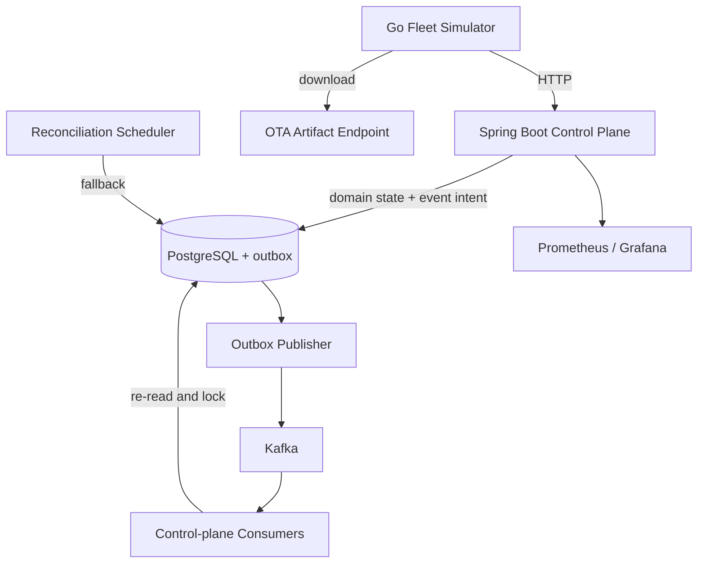

# Heimdall

[](https://github.com/filip-labs/Heimdall/actions/workflows/ci.yml)
[](LICENSE)

Heimdall is a connected-vehicle OTA control plane and fleet simulator built to explore reliable software delivery to software-defined vehicles.

## Overview

Heimdall has two main parts:

- A Spring Boot control plane that stores vehicle, release, deployment, event, and rollout state in PostgreSQL.
- A Go fleet simulator that runs many autonomous vehicle agents in one process.

The control plane exposes REST APIs for registering vehicles, receiving heartbeats, creating software releases, deploying releases to vehicles, and orchestrating staged fleet rollouts. The simulator registers deterministic VINs, sends heartbeats, polls for active deployments, downloads OTA artifacts, verifies SHA-256 integrity and Ed25519 release signatures, and reports deployment status back to the API.

## Why Heimdall Exists

Deploying vehicle software is not simply uploading a file. An OTA platform must account for intermittent connectivity, durable state, integrity checks, resumability, retries, staged rollout, blast radius control, health gates, and auditability.

Heimdall models those concerns in a compact project that is suitable for engineering discussion, local experimentation, and portfolio review.

## Current Architecture



The Spring Boot application uses package-by-domain organization:

```text
src/main/java/dev/heimdall/
├── HeimdallApplication.java
├── deployment/
├── messaging/
├── release/
├── rollout/
└── vehicle/
```

The Go simulator stays in one Go package while splitting responsibilities across files:

```text
simulator/
├── artifact_downloader.go
├── client.go
├── config.go
├── fleet.go
├── main.go
├── ota.go
├── vehicle_agent.go
└── vin.go
```

## Core Domains

- `Vehicle`: registered vehicle identity, software version, connectivity status, and heartbeat timestamps.
- `SoftwareRelease`: release version, artifact URL, checksum, and metadata.
- `Deployment`: a single vehicle OTA attempt for one release.
- `DeploymentEvent`: immutable audit record of deployment status transitions.
- `Rollout`: orchestration record for deploying one release to a snapshot of eligible vehicles.
- `RolloutStage`: cumulative rollout stage such as 5%, 25%, 50%, or 100%.
- `RolloutTarget`: immutable rollout membership snapshot ordered by VIN.

## OTA Lifecycle

Deployments progress through this state machine:

```text
PENDING
↓
DOWNLOADING
↓
DOWNLOADED
↓
INSTALLING
↓
INSTALLED
```

A deployment can move to `FAILED` from any non-terminal state when artifact download, checksum verification, or another OTA step fails. Repeated reports of the current status are idempotent, and each real transition creates a deployment event.

## Reliability

Heimdall currently includes:

- SHA-256 integrity and Ed25519 manifest verification before install.
- Transient artifact download retry with exponential backoff.
- Retry only for request-level transient errors and HTTP 5xx gateway/server failures.
- Source software version snapshot on deployment creation.
- Idempotent status updates from vehicle agents.
- Deployment event audit trail.
- Deterministic VINs with explicit fresh provisioning for simulator runs.
- Staged rollout with target snapshots and health gates.
- Operator-controlled rollout pause, resume, and cancel.
- Pessimistic database locking for rollout stage advancement.

## Operator Dashboard

The desktop-first React + TypeScript + Vite console covers fleet/vehicle state,
software releases and creation, staged rollout planning and controls, deployment
event timelines, and rollback inspection/actions. It follows the accepted Heimdall
Figma design; Grafana continues to own infrastructure metrics.

```bash
# Start the backend on localhost:8080, then (Node 22.14+ LTS):
cd dashboard
npm install
npm run dev
```

Open the URL printed by Vite. Relative `/api` requests are proxied to
`http://localhost:8080`; use `API_TARGET=http://localhost:8081 npm run dev` for another
local backend. No CORS changes are required. The interface assumes a trusted control
plane and does not implement operator authentication. Polling runs every eight
seconds and pauses in background tabs. Run `npm run typecheck`, `npm run lint`,
`npm test`, and `npm run build` for frontend validation.

See [API capabilities and metric semantics](docs/m13/api-capabilities.md) and the
[repeatable 100-vehicle dashboard demo](docs/m13/demo.md) for the isolated fixture,
acceptance evidence, screenshots and the M14 hosting decision.

## Fleet Simulation

Run the simulator after the control plane is available:

```bash
cd simulator
FLEET_SIZE=100 go run .
```

Useful environment variables:

```text
HEIMDALL_URL=http://localhost:8080
FLEET_SIZE=100
INITIAL_SOFTWARE_VERSION=1.3.0
HEARTBEAT_INTERVAL=5s
DEPLOYMENT_POLL_INTERVAL=3s
SIMULATED_FAILURE_VINS=7FC00000000000003
```

The simulator generates deterministic VINs, provisions and authenticates vehicles in a fresh disposable backend, sends heartbeats, polls for active deployments, processes OTA artifacts, and shuts down cleanly on `SIGINT` or `SIGTERM`.

`SIMULATED_FAILURE_VINS` is an optional comma-separated VIN list for deterministic OTA installation failures. Targeted vehicles still download the artifact, verify its SHA-256 checksum and Ed25519 signature, report `DOWNLOADED`, report `INSTALLING`, then report `FAILED` with `simulated installation failure` while keeping their previous software version.

## Staged Rollouts

Rollouts deploy one software release to the current eligible fleet in cumulative stages:

```text
5% -> 25% -> 50% -> 100%
```

For 100 target vehicles this means:

```text
5
+20
+25
+50
=100
```

Rollout targets are selected once at creation time from vehicles not already running the target release version, ordered by VIN ascending. Vehicles registered later are not added to the rollout.

Each stage creates deployments only for the incremental cohort. When all deployments in the current stage are terminal, Heimdall evaluates that stage's failure rate. If the failure rate is greater than the configured threshold, the current stage is marked `FAILED` and the rollout is `PAUSED`. If the failure rate is less than or equal to the threshold, the rollout advances to the next stage or completes.

Operators can pause, resume, or cancel a rollout with `POST /api/v1/rollouts/{id}/pause`, `POST /api/v1/rollouts/{id}/resume`, and `POST /api/v1/rollouts/{id}/cancel`. Pause and cancel stop future rollout progression without modifying existing deployments. Cancel is permanent and does not roll back already-installed vehicles.

Manual rollback is modeled as a new normal deployment with `POST /api/v1/deployments/{id}/rollback`. Heimdall uses the original deployment's `sourceSoftwareVersion` snapshot to find the previous `SoftwareRelease`, reuses that release's artifact URL and checksum, and leaves the original deployment and event history immutable.

```text
2.0.0
  -> deployment
2.1.0
  -> rollback deployment
2.0.0
```

Rollback deployments use the same OTA state machine, event trail, active-deployment protection, and vehicle software update behavior as any other deployment.

Automatic rollback is opt-in per rollout with `automaticRollbackEnabled`. When enabled, a health-gate failure still leaves the rollout `PAUSED` and the current stage `FAILED`; Heimdall then creates rollback deployments only for successfully installed deployments from that failed incremental stage. Failed installations, future stages, and vehicles that never received the bad release are untouched, and the rollout is not automatically resumed after recovery.

A manual demo can validate the health gate by configuring one canary to fail deterministically:

```bash
cd simulator
FLEET_SIZE=100 \
INITIAL_SOFTWARE_VERSION=2.0.0 \
SIMULATED_FAILURE_VINS=7FC00000000000003 \
go run .
```

With rollout stages `[5,25,50,100]` and a 5% failure threshold, VIN `7FC00000000000003` fails in the canary cohort, stage 0 pauses the rollout, and no deployments are created for stage 1.

## API Overview

Primary endpoint groups:

```text
/api/v1/vehicles
/api/v1/releases
/api/v1/deployments
/api/v1/rollouts
```

The Postman collection in `postman/Heimdall.postman_collection.json` covers the main vehicle, release, deployment, rollout, and health-check workflows. `postman/Local.postman_environment.json` targets `http://localhost:8080`.

## Technology Stack

- Java 21
- Spring Boot 4.1.1
- Maven
- PostgreSQL 17
- Flyway
- JPA/Hibernate
- Testcontainers
- Go
- Docker Compose
- Micrometer
- Prometheus
- Grafana
- Apache Kafka
- Postman

Redis is a roadmap item, not an implemented feature.

## Vehicle identity foundation (M11A)

Vehicle provisioning now returns a one-time credential, and a dedicated token API
issues short-lived signed vehicle tokens. Heartbeat, active-deployment polling and
vehicle status callbacks enforce authenticated ownership; the simulator refreshes
tokens in memory. Repeat runs require fresh disposable vehicle state. Startup
requires `HEIMDALL_SECURITY_VEHICLE_TOKEN_SECRET`; see
[Vehicle identity and authentication](docs/vehicle-identity.md) for local setup,
API behavior, migration strategy and security boundaries.

## Signed OTA releases (M11B)

New releases require a real SHA-256 digest and receive an Ed25519 signature.
Vehicles verify the signed version/digest manifest using a separately configured
public key before installation. Unsigned historical releases fail closed, including
rollback targets. See [OTA security](docs/ota-security.md) for the canonical format,
local key generation, required backend/simulator configuration and limitations.

## Security validation (M11C)

Security milestones: **M11A** implements authenticated vehicle identity; **M11B**
adds signed OTA authenticity; **M11C** adds threat modeling and security validation.
See the [threat model](docs/threat-model.md),
[regression matrix](docs/security-regression.md) and
[mTLS decision](docs/adr/001-mtls-device-authentication.md). Operator/provisioning
APIs assume a trusted control plane; deployment requires TLS. mTLS and production
fleet PKI are intentionally deferred.

## Running Locally

The full Compose stack is a local engineering environment: Heimdall, PostgreSQL,
Kafka, Prometheus and Grafana. It requires Docker Compose with BuildKit plus
Bash/OpenSSL for the one-time local key setup. It does not provide production
secret delivery, TLS termination, mTLS or production PKI.

### Full core stack

Prepare random local-development keys in an ignored `.env`, then start the stack:

```bash
bash scripts/dev/generate-compose-env.sh
docker compose up --build
```

The helper refuses to overwrite an existing file, creates it with mode 600,
prints no keys and removes temporary key files. `.env.example` documents the
variables without usable secrets; alternatively populate an ignored `.env` with
externally supplied values. The three backend signing variables are required:
Compose fails clearly if they are missing or empty. No application default keys
or build-time secrets are introduced. `.env` is excluded from Git and the Docker
build context. Do not share rendered `docker compose config` output: it contains
runtime secrets; use `docker compose config --quiet` for routine validation.

Heimdall waits for PostgreSQL and Kafka healthchecks and inherits the Dockerfile's
HTTP healthcheck. Prometheus starts independently and retries until Heimdall is
ready. Grafana uses its existing provisioned datasource and dashboard.

| Service | Host URL/port | Internal endpoint |
| --- | --- | --- |
| Heimdall | `http://localhost:8080` | `heimdall:8080` |
| PostgreSQL | `localhost:5433` | `postgres:5432` |
| Kafka | `localhost:9092` | `kafka:29092` |
| Prometheus | `http://localhost:9090` | `prometheus:9090` |
| Grafana | `http://localhost:3000` | `grafana:3000` |

```bash
docker compose ps
curl --fail http://localhost:8080/actuator/health
docker compose down
```

Health should return HTTP 200 with `status: UP`. The backend has a 60-second
stop grace period for Kafka and Spring shutdown. `down` preserves the named
PostgreSQL volume `heimdall_postgres_data`; a subsequent `up --build` reuses it.
Avoid `down -v` unless intentionally deleting disposable data.

### Direct host development

After preparing `.env` as above, run just the dependencies and export the generated
keys for the host process (Compose reads `.env` automatically; Java/Go do not):

```bash
docker compose up -d postgres kafka
set -a
. ./.env
set +a
./mvnw spring-boot:run
```

The host backend retains PostgreSQL `localhost:5433` (database/user/password
`heimdall`) and Kafka `localhost:9092` defaults. Stop the Compose backend before
running a host backend on port 8080. Provisioned observability targets the Compose
service `heimdall:8080`; it does not scrape a backend running on the host.
Use the backend's direct `/actuator/prometheus` endpoint during host development.

### Simulator

With the generated environment exported as above and the backend healthy:

```bash
(
  unset HEIMDALL_SECURITY_VEHICLE_TOKEN_SECRET HEIMDALL_SECURITY_VEHICLE_TOKEN_TTL
  unset HEIMDALL_SECURITY_RELEASE_SIGNING_PRIVATE_KEY HEIMDALL_SECURITY_RELEASE_SIGNING_KEY_ID
  cd simulator
  FLEET_SIZE=100 go run .
)
```

Only the public OTA key/key ID are needed by the simulator; never distribute the
backend private keys to vehicles. Its default URL is `http://localhost:8080`.
Repeat fleet provisioning needs fresh disposable vehicle state: credentials live
only in memory, and existing VINs cannot be provisioned again after a simulator
restart. See [vehicle identity](docs/vehicle-identity.md) and
[OTA security](docs/ota-security.md) for details.

An optional simulator Compose profile was evaluated and deferred. It would need
another image build, public-key delivery and an explicit fresh-state lifecycle;
a restart against the persistent database would fail duplicate VIN provisioning.
The host Go workflow keeps those concerns explicit without complicating the core
stack.

Historical k6 load scenarios and measurement constraints are documented in
[Scalability and load testing](docs/scalability-and-load-testing.md). They predate
M11 authentication and are not a current full-stack performance claim.

## Backend container image (M12A)

Build from a clean checkout; no local Maven installation or `target/` is needed:

```bash
docker build -t heimdall:local .
```

The multi-stage build uses Eclipse Temurin `21-jdk-noble` and the Maven Wrapper
to package the executable Spring Boot JAR with tests skipped. A BuildKit Maven
cache speeds up subsequent builds. The final `21-jre-noble` image runs
`java -jar /app/heimdall.jar` as dedicated UID/GID `10001:10001` (`heimdall`),
with no Maven or application sources. Both base images are pinned by multi-platform
manifest digest; update those pins deliberately for Java/OS security updates.
The JAR is read-only; Java/Tomcat may use
the runtime temporary directory. No platform is hardcoded.

Direct host development still uses `./mvnw spring-boot:run` with PostgreSQL at
`localhost:5433` and Kafka at `localhost:9092`. Container execution requires
reachable dependency endpoints supplied through the environment:

| Variable | Container configuration |
| --- | --- |
| `SPRING_DATASOURCE_URL` | For example `jdbc:postgresql://postgres:5432/heimdall` on the dependency network |
| `SPRING_DATASOURCE_USERNAME` / `SPRING_DATASOURCE_PASSWORD` | Credentials for that database |
| `SPRING_KAFKA_BOOTSTRAP_SERVERS` | For example `kafka:29092` on the dependency network |
| `HEIMDALL_SECURITY_VEHICLE_TOKEN_SECRET` | Externally supplied Base64 signing key, at least 32 decoded bytes |
| `HEIMDALL_SECURITY_VEHICLE_TOKEN_TTL` | Optional; default `5m` |
| `HEIMDALL_SECURITY_RELEASE_SIGNING_PRIVATE_KEY` | Externally supplied Base64 PKCS#8 DER Ed25519 private key |
| `HEIMDALL_SECURITY_RELEASE_SIGNING_KEY_ID` | Identifier matching the separately distributed simulator public key |

Generate/configure security keys using the linked M11 setup instructions above.
Supply secrets at runtime, never as build arguments or committed files. Existing
Spring environment binding, including `HEIMDALL_KAFKA_ENABLED`, remains available.
For a standalone manual run, keep the Compose `heimdall` service stopped, export
the variables above and pass them without literal secrets:

```bash
docker run --rm --name heimdall-backend-manual --network heimdall_default \
  -p 8080:8080 \
  -e SPRING_DATASOURCE_URL -e SPRING_DATASOURCE_USERNAME \
  -e SPRING_DATASOURCE_PASSWORD -e SPRING_KAFKA_BOOTSTRAP_SERVERS \
  -e HEIMDALL_SECURITY_VEHICLE_TOKEN_SECRET \
  -e HEIMDALL_SECURITY_VEHICLE_TOKEN_TTL \
  -e HEIMDALL_SECURITY_RELEASE_SIGNING_PRIVATE_KEY \
  -e HEIMDALL_SECURITY_RELEASE_SIGNING_KEY_ID \
  heimdall:local
```

Start dependencies first with `docker compose up -d postgres kafka`; use the
actual Compose network name if your project name differs from `heimdall`.
The image exposes port 8080. Its health contract is HTTP **200** from
`/actuator/health`; the Docker healthcheck uses curl already present in the
Temurin runtime, with a 60-second startup allowance. Only `health`, `info` and
`prometheus` remain exposed. `docker stop --time 60 heimdall-backend-manual` delivers
SIGTERM directly to Java and allows time for Kafka and Spring's graceful shutdown.

The full-stack Compose workflow above builds this same image. CI also builds it
independently on Ubuntu, starts only PostgreSQL, Kafka and Heimdall with a bounded
health wait, checks Flyway migrations and runs a vehicle POST/GET round-trip.
Security keys are generated only for that run; cleanup removes the CI volume and
temporary configuration. This validates packaging and basic integration, not
production deployment readiness. Image publishing is outside this milestone.

## Observability

The control plane exposes health, application information, and Prometheus
metrics through narrowly configured Actuator endpoints:

```text
http://localhost:8080/actuator/health
http://localhost:8080/actuator/info
http://localhost:8080/actuator/prometheus
```

Prometheus scrapes the Heimdall Compose service at `heimdall:8080` every five
seconds through `/actuator/prometheus`, entirely on the Compose network. Its UI
is available at `http://localhost:9090`; the `heimdall` target becomes `UP` once
the backend is ready. No host bridge is required.

Grafana is provisioned without manual setup at `http://localhost:3000`. Open
the `Heimdall / Heimdall Overview` dashboard to inspect:

- online and offline vehicles
- active and failed deployments
- running and paused rollouts
- committed OTA success/failure rates
- average time from deployment creation to its terminal outcome

The custom metrics use bounded `status` and `outcome` labels only. Generate
representative activity through the REST API or fleet simulator, then inspect
the Prometheus endpoint and dashboard. Stop the local services with:

```bash
docker compose down
```

## Event-Driven Control Plane

Kafka is Heimdall's internal responsive event backbone; PostgreSQL remains the
durable source of truth. Domain changes and event intent are written atomically
to a transactional outbox. A bounded publisher delivers JSON envelopes to
Kafka at least once, and idempotent consumers re-read PostgreSQL before they
trigger rollout evaluation or automatic rollback processing.

The Go simulator and vehicles continue to use HTTP only. Heartbeats are not
published because they are high-frequency and currently have no meaningful
asynchronous consumer.

The local KRaft broker listens on `localhost:9092`. Topics are created
automatically with three partitions and replication factor one:

- `heimdall.vehicle-events`
- `heimdall.deployment-events`
- `heimdall.rollout-events`

The normal event-driven path is backed by a slower 30-second reconciliation
scheduler, so a broker or consumer outage cannot permanently stall a rollout.
See [Event-Driven Control Plane](docs/event-driven-architecture.md) for event
contracts, ordering, delivery guarantees, consumers, and failure trade-offs.

Inspect the running broker without installing a local Kafka CLI:

```bash
# Topics
docker compose exec kafka /opt/kafka/bin/kafka-topics.sh \
  --bootstrap-server localhost:9092 --list

# Deployment events
docker compose exec kafka /opt/kafka/bin/kafka-console-consumer.sh \
  --bootstrap-server localhost:9092 \
  --topic heimdall.deployment-events --from-beginning

# Consumer groups and offsets
docker compose exec kafka /opt/kafka/bin/kafka-consumer-groups.sh \
  --bootstrap-server localhost:9092 --all-groups --describe

# Pending/retried outbox rows
docker compose exec postgres psql -U heimdall -d heimdall -c \
  "SELECT event_type, attempt_count, created_at, last_error FROM event_outbox WHERE published_at IS NULL ORDER BY created_at;"
```

## Tests

Run the Java tests:

```bash
./mvnw test
```

Run the Go simulator tests:

```bash
cd simulator
go test ./...
go test -race ./...
```

## Project Structure

```text
.
├── compose.yaml
├── observability/
│   ├── grafana/
│   └── prometheus/
├── postman/
├── simulator/
├── src/main/java/dev/heimdall/
│   ├── deployment/
│   ├── messaging/
│   ├── release/
│   ├── rollout/
│   └── vehicle/
├── src/main/resources/
│   ├── application.yml
│   ├── db/migration/       # includes V10 transactional outbox
│   └── static/artifacts/
├── docs/
│   └── event-driven-architecture.md
└── src/test/java/dev/heimdall/
    ├── deployment/
    ├── integration/
    ├── messaging/
    └── rollout/
```

## Engineering Decisions

- PostgreSQL stores durable vehicle, deployment, event, and rollout state.
- Flyway migrations are immutable once created.
- Deployment state transitions are protected by the `Deployment` entity.
- Deployment creation captures the source software version before OTA begins.
- Manual and rollout-created deployments share the same deployment creation path.
- Rollouts snapshot target membership and persist deterministic VIN ordering.
- Rollout stage advancement uses pessimistic locking on the rollout row.
- Stage health is calculated against the current stage's incremental cohort.
- Artifact integrity is verified before install.
- Simulator retries are limited to transient request errors and retryable HTTP statuses.
- Fleet and control-plane gauges read current PostgreSQL state at scrape time.
- OTA outcome and duration metrics are recorded only after a terminal status transaction commits.
- Deployment creation throughput is counted only after its transaction commits.
- Rollout evaluation duration includes locking, health checks, and stage advancement work.

## Project Resources

- [Heimdall Roadmap](https://github.com/users/filip-labs/projects/4/views/1)
- [GitHub Issues](https://github.com/filip-labs/Heimdall/issues)
- [Postman API collection](postman/Heimdall.postman_collection.json)
- [Architecture overview](#current-architecture)
- [Scalability and load testing](docs/scalability-and-load-testing.md)
- [Vehicle identity and authentication](docs/vehicle-identity.md)
- [OTA integrity and authenticity](docs/ota-security.md)
- [Threat model and security boundaries](docs/threat-model.md)
- [Security regression matrix](docs/security-regression.md)
- [ADR-001: mTLS and device certificates](docs/adr/001-mtls-device-authentication.md)

## Roadmap

```text
M1 Single Vehicle OTA                                Done
M2 Connectivity + Agent                              Done
M3 Artifact Integrity                                Done
M4 Reliability + Audit                               Done
M5 Fleet Simulator                                   Done
M6A Staged Fleet Rollouts                            Done
M6B Deterministic Failure Injection + Pause Demo     Done
M7A Manual Rollout Controls                          Done
M7B Rollback Deployments                             Done
M7C Automatic Rollback Policy                        Done
M8 Observability
M9 Kafka / Event-driven Architecture
M10 Scalability Testing
M11 Security
M12 Infrastructure + CI
M13 Operator Dashboard
M14 Documentation + Final Demo
```

## Scope

Heimdall is an engineering and portfolio simulation. It is not production automotive firmware infrastructure and does not implement the full safety, cybersecurity, certification, operational, or regulatory requirements of a real OEM OTA platform.
