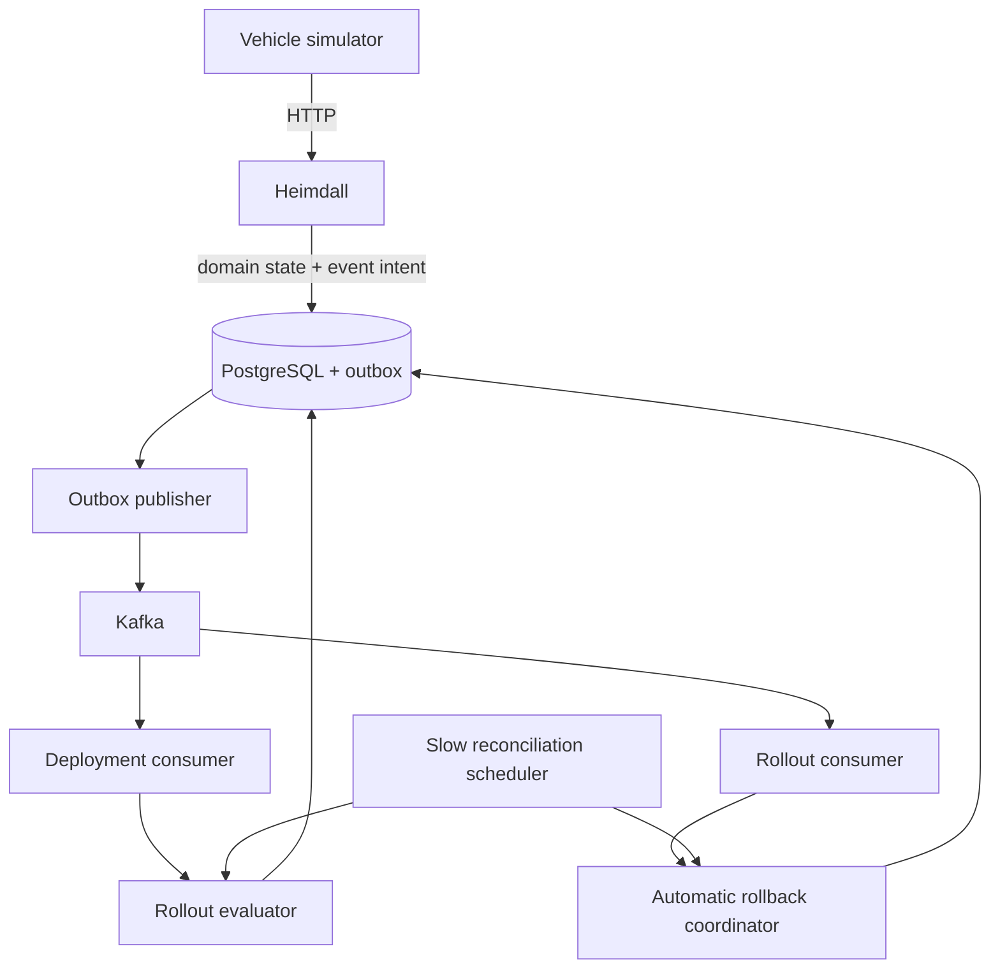

# Event-Driven Control Plane

## Why Kafka exists

Heimdall originally discovered every rollout change by scanning PostgreSQL on a short interval. M9 keeps that safe reconciliation model, but adds Kafka as a responsive internal trigger. A terminal OTA deployment can now prompt immediate rollout evaluation instead of waiting for the next scan.

Kafka is not the source of truth. PostgreSQL remains authoritative for vehicles, deployments, rollouts, stages, rollback state, and durable event intent.



The simulator remains an HTTP client. Vehicles do not need Kafka credentials, broker connectivity, or event-contract knowledge.

## Topics and ordering

| Topic | Key | Initial events |
|---|---|---|
| `heimdall.vehicle-events` | vehicle UUID | `vehicle.registered` |
| `heimdall.deployment-events` | deployment UUID | `deployment.created`, `deployment.status.changed` |
| `heimdall.rollout-events` | rollout UUID | rollout and stage lifecycle events |

Each topic has three partitions and replication factor one locally. Aggregate IDs are record keys, which preserves order for one aggregate but does not claim global ordering.

`vehicle.heartbeat` is intentionally absent: it is high-frequency, remains authoritative in PostgreSQL, and has no asynchronous consumer. `deployment.failed` is also absent because `deployment.status.changed` with `toStatus=FAILED` expresses the same fact without a redundant contract.

Unrecoverable deployment and rollout consumer records are moved after bounded retries to the corresponding `.DLT` topic.

## JSON envelope

Every record uses a dedicated versioned envelope:

```json
{
  "eventId": "uuid",
  "eventType": "deployment.status.changed",
  "schemaVersion": 1,
  "aggregateType": "deployment",
  "aggregateId": "uuid",
  "occurredAt": "UTC timestamp",
  "payload": {}
}
```

Payloads are contract data, not serialized JPA entities. They can evolve independently of the persistence model.

## Transactional outbox

The domain transaction writes both its state change and an `event_outbox` row. If PostgreSQL rolls back, neither survives. A separate bounded publisher sends pending rows and marks successful records as published.

Delivery is at least once. Kafka may accept a record immediately before the process crashes and before `published_at` is stored, so that row can be published again. Consumers are deliberately safe under duplicates: they re-read PostgreSQL, use existing state-machine checks, and retain the pessimistic rollout lock.

## Fast paths and reconciliation

A `deployment.status.changed` record triggers rollout evaluation only when it belongs to a rollout and reaches `INSTALLED` or `FAILED`. The consumer treats the record as “relevant state changed”; the evaluator still calculates health from PostgreSQL.

A health-gate `rollout.paused` event invokes the existing automatic rollback coordinator. Rollback selection and creation are not reimplemented in the consumer.

The scheduler now defaults to a 30-second reconciliation interval. It remains necessary for broker outages, delayed publication, consumer restarts, or operational mistakes. Correctness therefore does not depend on Kafka availability.

## Failure behavior

| Failure | Result |
|---|---|
| Database commit fails | No domain change and no durable outbox event |
| Kafka unavailable | Domain transaction can commit; outbox row remains pending with backoff and diagnostic error |
| Publisher crashes after send | Duplicate publication is possible and safe |
| Duplicate consumer record | PostgreSQL state machine and pessimistic lock prevent duplicate advancement |
| Consumer unavailable | Kafka retains records; consumer catches up and the scheduler reconciles meanwhile |
| Broker unavailable for an extended period | REST/domain correctness remains PostgreSQL-backed; pending backlog is observable |

## Trade-offs

- Local Compose uses one KRaft broker and replication factor one; it is not a production cluster design.
- JSON has no Schema Registry in M9. `schemaVersion` and contract tests provide the initial evolution boundary.
- At-least-once delivery means duplicates are expected.
- The scheduler still scans eligible state, but less frequently and as a safety path.
- Heimdall remains one modular Spring Boot deployment; Kafka is not used to manufacture microservices.
